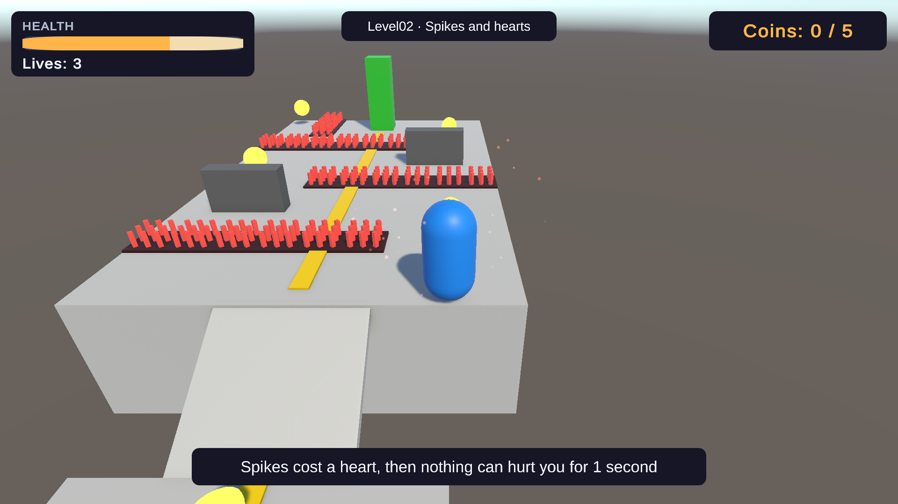
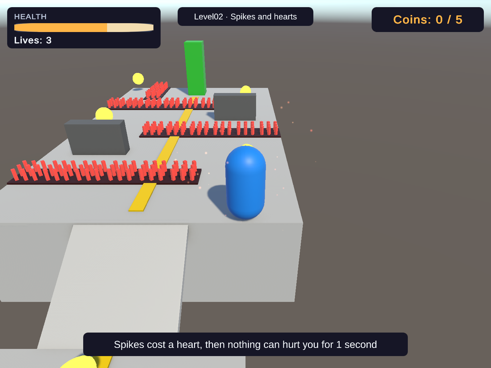
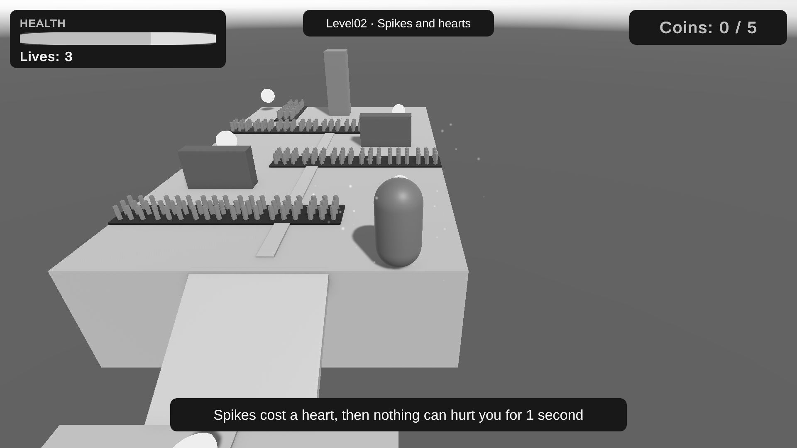
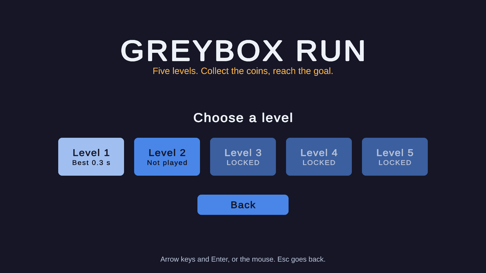
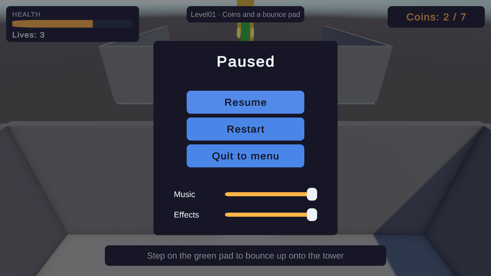
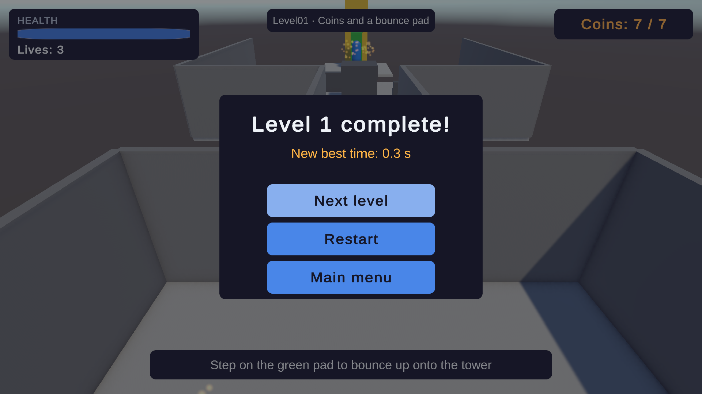

# CS464 Assignment 04 · Muhammad Talha · BSCS23051

**Video (90–180 s):** link coming soon

I started from my Assignment 03 repo (https://github.com/MTalha250/ITU-CS464-A3-BSCS23051), so the five levels, the player, the hazards, hearts and lives all carry over. The game is now seven scenes: MainMenu, Level01 to Level05 and Credits. Open `Assets/Scenes/MainMenu.unity` in Unity 6.3 (6000.6.3f1) and press Play. WASD or the arrows move, Space jumps, Esc pauses. Every menu works with the arrow keys and Enter.

## Settings

| Part | Setting | Value | Why |
|---|---|---|---|
| A | Harmony · base hue | complementary · 216° | Blue is calm, so it's the colour of the UI itself. Its complement, amber at 36°, is the colour of things you want: coins and the score. |
| A | Dark · mid · light | #121826 · #4A86E8 · #EEF2F8 | Panels, buttons and text. Their luminance is 0.009, 0.243 and 0.885, so they stay three clearly different greys in grayscale. |
| A | Accents | #FFB547 · #FF6B5B | Amber for the score, coins and the health bar at 2 hearts. Red is for danger: the last heart and Game over. It's outside the harmony on purpose, because players already read red as danger. |
| A | HUD text on its panel | 15.78 : 1 | White #EEF2F8 on the solid #121826 panel. The amber score on the same panel is 10.09 : 1 and the HEALTH label is 9.50 : 1. Every HUD text sits on a panel, never on the level. |
| A | Button label on the button | 4.95 : 1 | A dark #121826 label on the blue #4A86E8. White would only be 3.58 : 1, so I used dark labels. The button the keyboard is on turns #EEF2F8, which is 15.78 : 1 and the lightest thing on screen. |
| B | Music · SFX groups, as mixed | 0 dB · 0 dB | I left both groups at 0 dB and made the music quieter in the file itself (peaks at −9 dBFS, the effects at −2 to −6 dBFS), because the slider drives MusicVolume and would override a group setting anyway. |
| B | Slider at 1 · 0.5 · 0.0001 | 0 dB · −6.02 dB · −80 dB | Log10(value) × 20, measured in play mode. The slider stops at 0.0001 because Log10(0) is minus infinity. |
| C | Guard hum, in Level04 (and Level05) | Logarithmic · Min 1.5 m · Max 15 m | The guard is about 1 m wide, so it's full volume within 1.5 m. Logarithmic drops 6 dB per doubling, so you can just hear it across the 18 m hall before it's close enough to chase you (4 m). |
| C | Goal chime, in Level01 (every level) | Linear · Min 3 m · Max 22 m | Linear is silent at 22 m, so the chime doesn't play over the whole level. In Level01 the goal is 33.5 m from the start, so you start to hear it at the end of the corridor, and it gets louder all the way to the goal. |
| C | AudioListener | on the player, not the camera | My camera follows 8.06 m behind and above the player (offset 0, 4, −7). With the listener there, every 3D sound would be judged from the wrong place. ListenerOnPlayer puts it at the player, turned the way the camera faces. |
| D | unlocked | int · default 1 | Level 1 is always open, even on a first run. |
| D | best1 … best5 | float · HasKey first | A missing time reads as 0, which would look like a perfect run, so SaveData checks HasKey before comparing. |
| D | MusicVolume (and SfxVolume) | float · default 1 | 1 is 0 dB, so the first run plays at full volume. The key is the mixer parameter's own name. |

## Answers

1. **What `Time.timeScale = 0` stops in my game, and what it doesn't:** It stops everything on scaled time: physics and FixedUpdate (the player's movement and the guards' MovePosition), the crusher's and the speed boost's WaitForSeconds, the respawn delay, and the coins spinning by deltaTime. It doesn't stop Update or input. PauseMenu still reads Esc, so PlayerController returns early while IsPaused. The UI, the health bar's lag and the red flash also keep running, because they use unscaled time.

2. **What survives a LoadScene in my game, and how:** The Music object and the SfxPlayer survive through DontDestroyOnLoad, and each has a singleton check so a second copy destroys itself. PauseMenu.IsPaused, AudioListener.pause and Time.timeScale also survive, so Restart and Quit call Resume() first, and LevelLoader.Load sets the time back to 1. The static GameEvents event survives too. The unlocks, best times and volumes are in PlayerPrefs, on disk. Everything else is made again.

3. **Why every PlayerPrefs read in my game has a default:** On the first run, or after Clear All PlayerPrefs, none of the keys exist. GetInt("unlocked", 1) keeps Level 1 open instead of locking everything at 0. The volume default of 1 means 0 dB rather than a silent slider. Best times use HasKey first, because a missing time reads as 0 seconds and no real run could ever beat it.

4. **An exception a forgotten unsubscribe would throw, and why mine can't:** HitFlash subscribes to the static GameEvents.PlayerDamaged. Without the `-=`, a restart would leave the old HitFlash in the event's list after its scene was destroyed. The next hit would call Flash on it and touch its destroyed overlay Image, which throws a MissingReferenceException. Every listener of mine (HealthBar, HurtSound, HitSparks, HitFlash) does `+=` in OnEnable and `-=` in OnDisable, which runs when the scene unloads.

## Credits

- Music loop (Music.wav, Am–F–C–G) · made by me with `Tools/make_audio.py` · in this repo · made for this assignment, no third-party audio
- Coin, Hit, Click, Win and Lose sounds · made by me with `Tools/make_audio.py` · in this repo · made for this assignment
- Guard hum and goal chime (3D sounds) · made by me with `Tools/make_audio.py` · in this repo · made for this assignment
- Liberation Sans (the TextMesh Pro default font) · Steve Matteson for Red Hat · https://github.com/liberationfonts · SIL Open Font License 1.1
